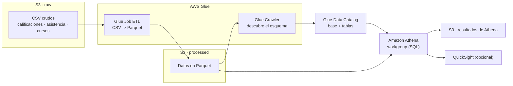

# Arquitectura — Plataforma de Datos Educativos

> Plantilla para que documentes **tu** diseño. Complétala a medida que construyes tu stack de CDK.

---

## 1. Diagrama de arquitectura

_Este es un diagrama de referencia. Reemplázalo por el tuyo a medida que diseñas tu pipeline._

---

## 2. Componentes

| Componente | Servicio AWS | Responsabilidad | Decisiones de diseño |
|---|---|---|---|
| Data Lake | S3 | _¿Cuántos buckets? ¿raw / processed / resultados?_ | |
| ETL | Glue Job | _¿Qué construct? ¿cómo pasas las rutas raw/processed?_ | |
| Esquema | Glue Crawler | _¿Qué carpeta recorre? ¿cada cuánto corre?_ | |
| Catálogo | Glue Data Catalog | _¿Nombre de la base? ¿tablas?_ | |
| Consulta | Athena | _¿Workgroup? ¿dónde guarda resultados?_ | |
| Permisos | IAM | _¿Qué necesita el rol de Glue?_ | |

---

## 3. Flujo de datos

- ¿Cómo suben los CSV al bucket `raw`? (¿a mano, con un BucketDeployment, otro?)
- ¿Qué formato de salida eliges y por qué? (Parquet vs CSV)
- ¿En qué orden se ejecuta todo? (Job → Crawler → Athena)

_Completa aquí tu razonamiento._

---

## 4. Seguridad y acceso

- ¿Qué permisos mínimos tiene el rol IAM de Glue sobre cada bucket?
- ¿Athena puede leer el bucket `processed`? ¿Cómo lo garantizas?
- ¿Los buckets bloquean acceso público?

---

## 5. Flujo de despliegue

- Lenguaje elegido para CDK: `______`
- Comando(s) para desplegar: `cdk deploy`
- Pasos tras el deploy: correr el **Job** → correr el **Crawler** → consultar en **Athena**
- Comando(s) para destruir: `cdk destroy`

---

## 6. Boss Fight (si lo abordaste)

- ¿Qué **DPU / Workers** configuraste para el nuevo volumen (100 GB/mes)?
- ¿Cómo **particionaste** los datos en S3 (`year/month`)?
- ¿Habilitaste **Glue Job Bookmarks**? ¿Para qué sirvieron?
- **Costo de Athena:** ¿cuánto escaneaba una query antes vs. después de particionar?

_Completa aquí tu solución._
