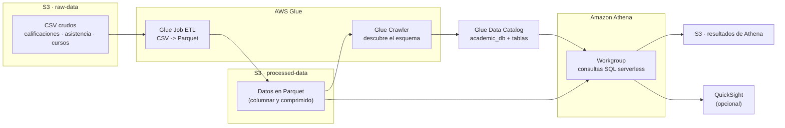

# Arquitectura del pipeline

Diagrama de referencia del pipeline que debes construir. Las piezas exactas (nombres,
configuración) las defines tú con AWS CDK.

## Flujo

1. Los **CSV crudos** se guardan en el bucket `raw-data`.
2. El **Glue Job** los transforma a **Parquet** y los escribe en `processed-data`.
3. El **Crawler** recorre `processed-data`, descubre el esquema y registra las tablas
   en el **Data Catalog** (`academic_db`).
4. **Athena** consulta esas tablas con SQL; los resultados se guardan en un bucket de S3.
5. (Opcional) **QuickSight** se conecta a Athena para visualizar los datos.
